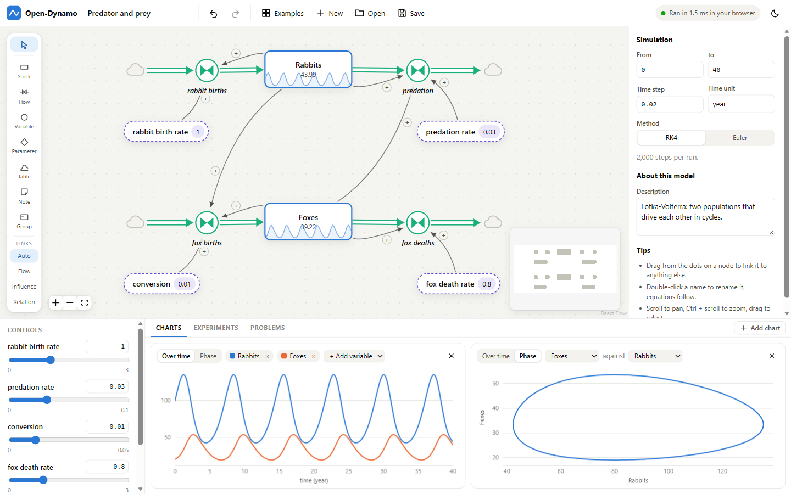

# Open-Dynamo

Open-Dynamo is a free tool for building and simulating models of dynamical systems: draw the system as a diagram,
write a formula in each node, and watch it run as you build it.

It is made for teaching. Students need only a web browser. A university (or anyone) runs one small server, and the
heavy computing happens there rather than on the student's laptop.



## What you can do with it

- **Draw models on an open canvas.** Stocks, flows, variables, parameters, lookup tables, notes and groups. Any node
  can link to any other node; the link type decides what the link means.
- **See results immediately.** Each model is compiled to WebAssembly and runs in the browser, so moving a slider
  redraws every chart at once. A typical course model runs in about a millisecond.
- **Run experiments that need many simulations**, on the server: parameter sweeps, uncertainty analysis (Monte Carlo),
  fitting a model to measured data, and optimisation.
- **Start from worked examples**: cooling, logistic growth, an SIR epidemic, Bass diffusion, predator and prey,
  mass-spring-damper, PI level control, a supply chain with delays, and the Lorenz attractor.

## Run it

### With Docker (the simplest way to host it)

```bash
docker compose up -d        # then open http://localhost:8000
```

or without Compose:

```bash
docker build -t open-dynamo .
docker run -d -p 8000:8000 open-dynamo
```

That one container serves the web app and does the computing. Put it behind your usual HTTPS reverse proxy and give
students the address. The image is about 900 MB, most of it the C compiler that turns models into fast code.

### From source

You need [uv](https://docs.astral.sh/uv/) and Node.js 20 or newer.

```bash
cd web && npm install && npm run build && cd ..     # builds the web app into the Python package
uv run opendynamo serve                             # http://127.0.0.1:8000
```

The first model compiled on a machine takes about half a minute while the bundled C compiler prepares itself (the
Docker image does this while it builds). After that a new model compiles in about 0.1 s on Linux and 0.5 s on Windows,
and a model the server has seen before is instant.

## Building a model

| Node | What it is | What you give it |
|---|---|---|
| **Stock** | A quantity that accumulates (water in a tank, people infected, velocity) | Its starting value |
| **Flow** | A rate that fills or drains a stock, drawn as a valve | A formula |
| **Variable** | Anything calculated from other things | A formula |
| **Parameter** | A constant, shown as a slider | A value and a slider range |
| **Table** | A curve through points, read at some input (usually time) | The points |
| **Note**, **Group** | Explanation and layout | Text |

| Link | What it means |
|---|---|
| **Flow** | Quantity leaves the source and enters the target, where those are stocks. The rate is the flow node on the pipe, or a formula typed on the link itself. |
| **Influence** | The source is an input of the target. Formulas refer to nodes by name, so these links are drawn for you when a formula mentions a node. Each can be marked + or −. |
| **Relation** | A labelled line that has no effect on the simulation, for causal sketches and annotations. |

Dragging from one stock to another puts a valve on the pipe for you. Dropping a link on empty canvas offers to create
the node it leads to.

Formulas use other nodes' names, with spaces written as underscores (`contact_rate * Susceptible`). Available:

| | |
|---|---|
| Arithmetic | `+ - * / ^ %`, comparisons, `and or not`, `a if condition else b` |
| Maths | `min max abs sqrt exp log log10 sin cos tan asin acos atan atan2 sinh cosh tanh floor ceil round sign`, `clip(x, lo, hi)`, `div(a, b)` |
| Inputs over time | `step(height, at)`, `ramp(slope, from, to)`, `pulse(at, width, every)`, `time`, `dt`, `pi` |
| Delays | `smooth(x, time)`, `delay(x, time)`, `delay1(x, time)`, `delay3(x, time)` |
| Curves | `lookup(x, [x1, x2, ...], [y1, y2, ...])`, or a Table node |
| Random | `rand()` (uniform 0 to 1), `randn()` (standard normal); repeatable for a given seed |

Integration is fixed-step, by Euler's method or fourth-order Runge-Kutta (the default).

Models are saved in the browser as you work, and can be downloaded and opened as `.dynamo.json` files. That is how
students hand in work and how staff share models.

## Hosting it for a class

The server keeps **no user data**: every request carries the model it concerns, and nothing is stored but a cache of
compiled kernels. There are no accounts. If you want to restrict who can use it, do that at your reverse proxy
(single sign-on, an IP range, or a shared password).

What a student types is never executed. Formulas are parsed, checked against a whitelist of arithmetic and the
functions above, and re-emitted as generated code; only that generated code is compiled and run.

Settings are environment variables:

| Variable | Default | Meaning |
|---|---|---|
| `OPENDYNAMO_MAX_WORK` | `5e9` | Largest experiment allowed: equations × time steps × runs |
| `OPENDYNAMO_MAX_STEPS` | `2000000` | Most time steps in one run on the server |
| `OPENDYNAMO_JOBS` | `2` | Experiments computed at once (others wait their turn) |
| `OPENDYNAMO_THREADS` | all cores | Threads one experiment uses |
| `OPENDYNAMO_CACHE` | `~/.cache/opendynamo` | Where compiled kernels are kept |
| `OPENDYNAMO_CACHE_FILES` | `3000` | Files kept in that cache before the oldest are removed |

Sizing: ordinary runs cost the server nothing, because browsers do them. The server compiles a model when its
structure changes (a fraction of a second of one core) and runs experiments. Measured on a 16-thread laptop with the SIR
example (10 equations, 400 steps): a 500-run uncertainty analysis takes 0.09 s, a 5,000-run one 0.15 s, and fitting
two parameters to data takes 0.06 s (about 1,500 runs). The default `OPENDYNAMO_MAX_WORK` allows experiments of up to
roughly five seconds on that machine; scale it to yours.

## How it works

```
 browser                                        server (Python)
 ───────                                        ───────────────
 canvas editor (React, React Flow) ── model ──► model.py     diagram ─► equations, problems reported per node
 worker.ts: runs the kernel       ◄── wasm ──   expr.py      safe formula compiler ─► C (and numpy, for checking)
 charts, sliders                                kernel.py    C ─► WebAssembly for the browser
 experiments panel ── model + settings ───────►              C ─► native library, run across all cores
                   ◄── results ──────────────   analysis.py  sweep, Monte Carlo, fit, optimise
```

One set of generated equations runs on three backends: WebAssembly in the browser, a native library on the server, and
a numpy reference implementation that the tests compare the other two against.

## Using the engine from Python

```python
import json
from opendynamo import Model
from opendynamo import analysis as A

model = Model(json.load(open("sir.dynamo.json")))
run = model.simulate({"contact_rate": 0.6})              # run["Infected"] is (samples, scenarios)
fit = A.optimise(model, [{"param": "contact_rate", "min": 0.1, "max": 2}],
                 {"kind": "fit", "targets": [{"var": "Infected", "t": times, "y": cases}]})
```

`opendynamo run model.json --csv out.csv` simulates a saved model from the command line.

## Developing

```bash
uv run opendynamo serve            # API on :8000
cd web && npm run dev              # web app on :5173 with hot reload, proxying /api to :8000
uv run pytest                      # engine and server tests (the WebAssembly test needs Node)
uv run python scripts/check_examples.py
```

The code is small on purpose: `src/opendynamo` is the engine and server (about 1,900 lines) and `web/src` is the app
(about 2,100).

## Current limits

- Fixed time step only; there is no adaptive or implicit solver yet, so stiff systems need a small step.
- No units checking: units are labels.
- No arrays or sub-models: one diagram, scalar variables.
- A change to a model's structure is compiled on the server before results update, so it needs the server to be
  reachable and takes a moment (see the compile times above). Changing numbers does not.
- Non-negative stocks are clamped at zero after each step; outflows are not throttled to match.
- No accounts and no shared editing: a model lives in one browser until it is saved to a file.
- The web app has been exercised by hand and by scripted browser sessions, but has no automated UI tests yet.

## Licence

Apache License 2.0. See [LICENSE](LICENSE) and [NOTICE](NOTICE).
